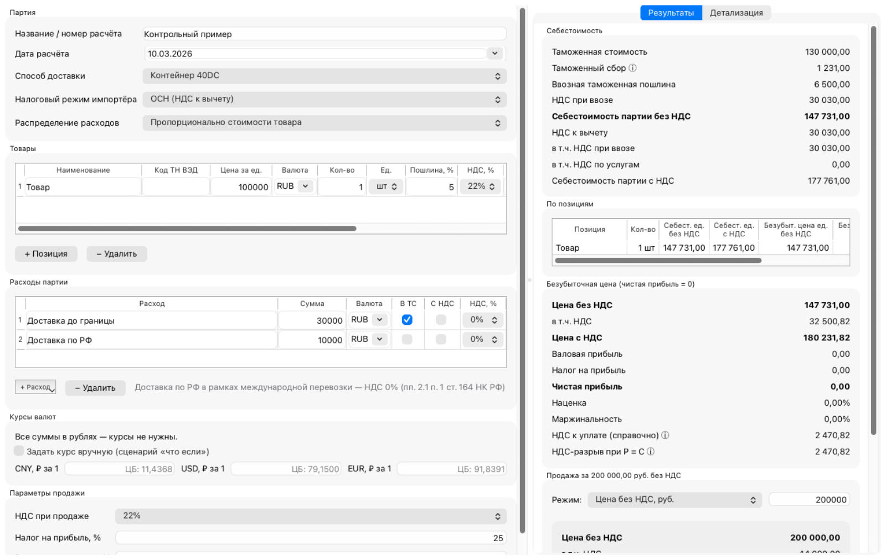
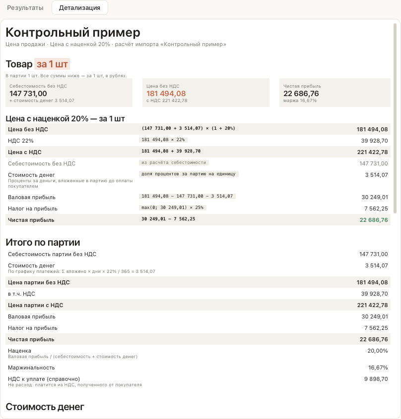

# Калькулятор ВЭД

Десктоп-приложение для macOS. Оно считает **полную себестоимость импорта** партии товара в РФ:
товар, логистику, таможенный сбор, пошлину и НДС при ввозе. По себестоимости оно считает
**цену продажи B2B-клиенту**: безубыточную, с заданной наценкой, маржой или чистой прибылью.
Есть и обратный расчёт: по известной цене программа показывает прибыль и рентабельность.

Это первый модуль будущей платформы инструментов ВЭД. Ядро расчётов не зависит от
интерфейса, поэтому поверх него можно сделать CLI, веб-версию или API.



> Программа даёт оценку для управленческого решения. Она **не заменяет консультацию
> таможенного брокера и бухгалтера**.

## Возможности

- Несколько позиций в одной партии. У каждой позиции своя валюта, ставка пошлины и ставка
  НДС (22%, 10% или 0%), единицы — шт, кг или т.
- Расходы партии с признаками «включается в таможенную стоимость» и «сумма с НДС»,
  входящий НДС по российским услугам принимается к вычету.
- Курсы ЦБ РФ на дату расчёта загружаются в фоне, учитывают номинал и кэшируются.
  Без интернета берётся последний сохранённый курс с предупреждением. Курс можно задать
  вручную для сценария «что если».
- Таможенный сбор считается по шкале 2026 года от общей таможенной стоимости партии.
- Налоговые режимы импортёра: ОСН (НДС к вычету) и УСН «доходы минус расходы» без НДС.
- Цена продажи — безубыточная, с наценкой, с маржинальностью, с целевой чистой прибылью
  или обратный расчёт по цене. Учитываются расходы, зависящие от выручки: комиссия,
  эквайринг, бонус клиенту.
- **Упор на единицу товара**: себестоимость, безубыточная цена и цена по сценарию —
  за 1 шт, 1 кг или 1 т (как задана позиция), с разбивкой по статьям. Итоги партии — ниже.
- Пересчёт на лету и пошаговая детализация всех формул с подставленными числами.
- Оформление в духе приложения Claude для macOS: тёплая светлая палитра, карточки, формулы
  моноширинным шрифтом.
- Расчёт сохраняется в JSON и открывается снова, его можно дублировать. Результат
  экспортируется в PDF и XLSX.

## Установка

### Готовая сборка (.dmg)

1. Скачайте `.dmg` для вашего Mac со страницы **Releases** этого репозитория:
   - `arm64` — для Mac на Apple Silicon (M1–M4);
   - `x86_64` — для Mac на Intel.
2. Откройте `.dmg` и перетащите «Калькулятор ВЭД» в «Программы».
3. При первом запуске macOS предупредит, что приложение от неустановленного разработчика:
   сборка пока не подписана сертификатом Apple Developer. Откройте приложение через
   **правый клик → «Открыть» → «Открыть»**. Если кнопки «Открыть» нет, разрешите запуск в
   «Системные настройки → Конфиденциальность и безопасность → Всё равно открыть».

### Обновление

Начиная с версии 0.2.0 программа обновляется сама. Раз в сутки при запуске (и по команде
**Справка → Проверить обновления…**) она смотрит последний релиз на GitHub. Если вышла новая
версия, программа показывает список изменений. Дальше можно выбрать:

- **Установить и перезапустить.** Программа скачает `.dmg` для вашего Mac и сверит его
  контрольную сумму SHA-256. После выхода она заменит себя новой версией и запустится снова.
  Перед выходом она спросит, сохранить ли открытый расчёт.
- **Скачать вручную.** Откроется ссылка на `.dmg`.
- **Пропустить эту версию** или **Позже**.

Ограничения:
- Обновиться с 0.1.0 на 0.2.0 нужно вручную, потому что в 0.1.0 этой функции ещё нет.
  Перетащите новое приложение в «Программы» и выберите «Заменить».
- Если у программы нет прав на запись в папку, где она установлена, доступно только
  скачивание вручную.

Файлы расчётов и кэш курсов при обновлении сохраняются.

### Из исходников

Нужен Python 3.12 или новее.

```bash
git clone <адрес репозитория> vedcalc
cd vedcalc
python3 -m venv .venv
.venv/bin/pip install -e ".[gui,dev]"
.venv/bin/python -m vedcalc        # запуск приложения
.venv/bin/pytest                   # тесты
.venv/bin/ruff check .             # линтер
```

Собрать `.app` и `.dmg` локально:

```bash
scripts/build_macos.sh             # результат — в dist/
```

## Быстрый старт: контрольный пример

**Файл → Открыть контрольный пример**. Условия примера:

| Параметр | Значение |
|---|---|
| Товар | 100 000 ₽, 1 позиция, пошлина 5%, НДС 22% |
| Доставка до границы | 30 000 ₽ (входит в таможенную стоимость, НДС 0%) |
| Доставка по РФ | 10 000 ₽ (часть международной перевозки, НДС 0%) |
| Режим | ОСН, налог на прибыль 25% |

Ожидаемый результат (совпадает до копейки, проверяется тестом `tests/test_control_example.py`):

| Показатель | Значение |
|---|---|
| Таможенная стоимость | 130 000,00 |
| Таможенный сбор (ТС ≤ 200 000) | 1 231,00 |
| Пошлина | 6 500,00 |
| НДС при ввозе = НДС к вычету | 30 030,00 |
| **Себестоимость без НДС (C)** | **147 731,00** |
| Безубыточная цена с НДС | 180 231,82 |
| НДС-разрыв при P = C | 2 470,82 |
| Продажа за 200 000 без НДС: чистая прибыль | 39 201,75 |
| Наценка / маржинальность | 35,38% / 26,13% |

## Методика расчёта

Все суммы переводятся в рубли по курсу ЦБ РФ на дату расчёта (или по ручному курсу).

### Себестоимость

1. **Распределение расходов партии** по позициям: пропорционально стоимости товара (по
   умолчанию) или весу брутто. Доли округляются до копеек, остаток от округления относится
   на последнюю позицию.
2. **Таможенная стоимость (ТС)** позиции = стоимость товара + доля расходов
   с признаком «включается в ТС», без НДС.
3. **Таможенный сбор** = по шкале от **общей ТС** партии (одна ДТ). По позициям сбор
   распределяется пропорционально ТС. Сбор **не входит** в базу пошлины и НДС.
4. **Пошлина** = ТС × ставка (адвалорная).
5. **НДС при ввозе** = (ТС + пошлина + акциз) × ставка НДС.
6. **Себестоимость без НДС (C)** = товар + все расходы без НДС + сбор + пошлина + акциз.
   - ОСН: НДС при ввозе и входящий НДС по услугам в себестоимость не входят. Это
     **НДС к вычету I**, он показывается отдельно.
   - УСН без НДС: весь НДС включается в себестоимость.
7. **Себестоимость единицы** = себестоимость позиции / количество.

Пошлина и НДС при ввозе округляются до копеек по каждой позиции, остальное — только при
выводе. Деньги считаются в `Decimal`, без `float`.

### Цена продажи

Обозначения:
- C — себестоимость без НДС;
- P — выручка без НДС;
- v — НДС при продаже (22%);
- t — налог на прибыль (25%; при УСН — ставка УСН, 15%);
- r — доля расходов, зависящих от цены (без НДС).

| Показатель | Формула |
|---|---|
| Валовая прибыль G | P − C − r·P |
| Налог на прибыль | max(0, G) × t |
| Чистая прибыль | G − налог |
| Наценка | G / C |
| Маржинальность | G / P |
| НДС к уплате (справочно) | D = P·v − I |

| Режим | Цена без НДС |
|---|---|
| Безубыточная (чистая прибыль = 0) | P = C / (1 − r) |
| Наценка k | P = C · (1 + k) / (1 − r) |
| Маржинальность m | P = C / (1 − m − r) |
| Целевая чистая прибыль N | P = (C + N / (1 − t)) / (1 − r) |
| Цена за единицу (одна позиция) | P = цена за 1 ед. × количество |
| Обратный расчёт | P задана, считаются все показатели |

При r = 0 формулы совпадают с классическими: P = C, P = C·(1+k), P = C/(1−m), P = C + N/(1−t).
Безубыточная цена округляется до копеек **вверх**, иначе чистая прибыль ушла бы в минус
на доли копейки.

**НДС к уплате** — не расход: он платится из НДС, полученного от покупателя, и в прибыль не
входит. **НДС-разрыв** — это D при P = C. Он возникает на тех частях себестоимости, где нет
входящего НДС: таможенный сбор, доставка с НДС 0%, разница ставок 10% и 22%.

### На единицу товара

Для каждой позиции программа показывает расчёт за 1 шт, 1 кг или 1 т — в той единице,
в которой задано количество:

- Статьи себестоимости делятся на количество: товар, доставка до границы, пошлина, сбор,
  прочие расходы.
- Каждая статья округляется до копеек. Себестоимость единицы — сумма округлённых статей.
- Цена и прибыль на единицу считаются от себестоимости единицы по тем же формулам. Например,
  для наценки: цена = себестоимость единицы × (1 + k).

Так каждая формула на экране сходится до копейки. Итоги по партии считаются отдельно, поэтому
«цена единицы × количество» может отличаться от цены партии на несколько копеек.



## Источники данных и как их обновить

### Курсы валют

- Источник: ЦБ РФ, `https://www.cbr.ru/scripts/XML_daily.asp?date_req=ДД/ММ/ГГГГ`.
- **Все курсы берутся на дату расчёта**: к товару, логистике и базе таможенных платежей.
  Курсы на дату оплаты и на дату регистрации ДТ заранее неизвестны.
- Кэш хранится в `~/Library/Application Support/vedcalc/fx_cache.json`. Если удалить
  файл, курсы загрузятся заново.

### Шкала таможенных сборов

- Файл `vedcalc/data/customs_fees_2026.json`.
- Основание: **ПП РФ от 28.11.2024 № 1637 в ред. ПП РФ от 23.10.2025 № 1638**,
  действует с **01.01.2026**.
- Пороги сверены 26.10.2026 с текстом постановления и таблицей ФТС
  ([customs.gov.ru](https://customs.gov.ru/fiz/uplata-tamozhennyx-platezhej/stavki-tamozhennyx-sborov-za-sovershenie-tamozhennyx-operaczij,-svyazannyx-s-vypuskom-tovarov-dlya-lichnogo-pol-zovaniya)).

| Общая таможенная стоимость, руб. | Сбор, руб. |
|---|---|
| до 200 000 включительно | 1 231 |
| 200 000,01 – 450 000 | 2 462 |
| 450 000,01 – 1 200 000 | 4 924 |
| 1 200 000,01 – 2 700 000 | 13 541 |
| 2 700 000,01 – 4 200 000 | 18 465 |
| 4 200 000,01 – 5 500 000 | 21 344 |
| 5 500 000,01 – 10 000 000 | 49 240 |
| свыше 10 000 000 | 73 860 |

Когда выйдет новая шкала:
1. Создайте файл `customs_fees_<год>.json` в том же формате: `valid_from`, `legal_basis`,
   `source_url`, `brackets`. Последний порог — `"up_to": null`.
2. Поменяйте `DEFAULT_SCALE` в `vedcalc/core/fees.py`.
3. Обновите тест границ `tests/test_fees.py`.

Если дата расчёта выходит за период действия шкалы, программа показывает предупреждение.

### Ставки по умолчанию

`vedcalc/data/settings.json`: НДС, налог на прибыль, ставка УСН, список валют.

## Допущения и ограничения

Полный список — в [docs/ASSUMPTIONS.md](docs/ASSUMPTIONS.md). Главное:

- один курс ЦБ на дату расчёта для всех операций;
- одна декларация на партию;
- пошлина только адвалорная: специфическая и комбинированная ставки есть в модели,
  но пока не считаются;
- акциз вводится вручную;
- не учитываются особые ставки сбора (радиоэлектроника), преференции по стране
  происхождения и антидемпинговые пошлины;
- УСН «доходы» и УСН с НДС 5% или 7% не поддерживаются;
- налог на прибыль считается по одной сделке, без учёта прочих доходов и убытков компании.

## Дорожная карта

- [ ] Подстановка ставок по коду ТН ВЭД (`TnvedRateProvider`): локальная база, затем API или
      LLM-подбор кода с подтверждением пользователем.
- [ ] Специфические и комбинированные ставки пошлины, акциз по ставкам.
- [ ] Калькулятор загрузки контейнера или фуры по весу и объёму.
- [ ] Модуль «Цена для маркетплейса (WB)»: комиссия, логистика, хранение, эквайринг.
- [ ] Преференции по стране происхождения, антидемпинговые пошлины, сертификаты.
- [ ] История расчётов и сравнение сценариев («море vs ж/д»).
- [ ] Подпись и нотаризация сборки, иконка приложения.
- [ ] Локализация интерфейса (EN), сборка под Windows.

## Структура проекта

```
vedcalc/
  core/        ядро без GUI: models, money, units, fx, fees, customs, costing,
               pricing, validation, report, io, settings
  providers/   интерфейсы внешних источников (tnved.py — заглушка)
  modules/     будущие модули и реестр вкладок (registry.py)
  reports/     HTML- и XLSX-отчёты
  gui/         PySide6: главное окно, форма, результаты, экспорт PDF
  data/        шкала сборов, настройки, контрольный пример
tests/         pytest; GUI-тесты — pytest-qt (без экрана)
docs/          ASSUMPTIONS.md, скриншоты
scripts/       сборка .app и .dmg
```

Новые модули подключаются как вкладки главного окна через
`vedcalc.modules.registry.register(...)`, без правки ядра.

## Как внести вклад

1. Ветка `main` защищена, изменения вносятся только через pull request.
2. Создайте ветку от `main`: `feature/<кратко>` или `fix/<кратко>`.
3. Перед PR выполните `ruff check .`, `ruff format --check .` и `pytest`. CI проверит то же
   самое.
4. Любое изменение методики сопровождается тестом с ручным расчётом и записью в
   `docs/ASSUMPTIONS.md`.
5. Запишите изменения в `CHANGELOG.md` в раздел «Не выпущено».

Релиз: обновить версию в `pyproject.toml` и `vedcalc/__init__.py`, перенести записи
в `CHANGELOG.md` и поставить тег `vX.Y.Z`. GitHub Actions соберёт `.dmg` и опубликует
GitHub Release.

## История версий

См. [CHANGELOG.md](CHANGELOG.md).

## Лицензия

Проприетарная, все права защищены. См. [LICENSE](LICENSE).
