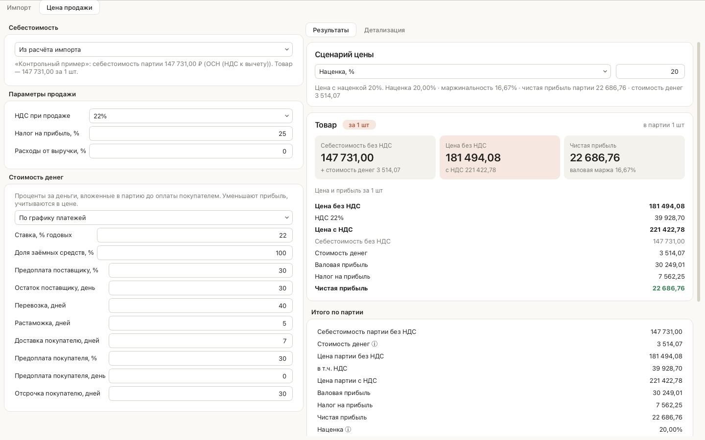
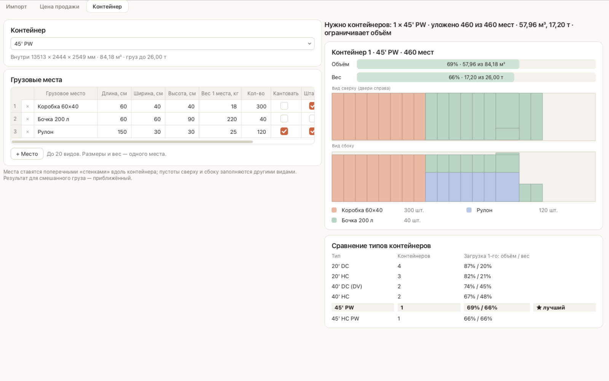
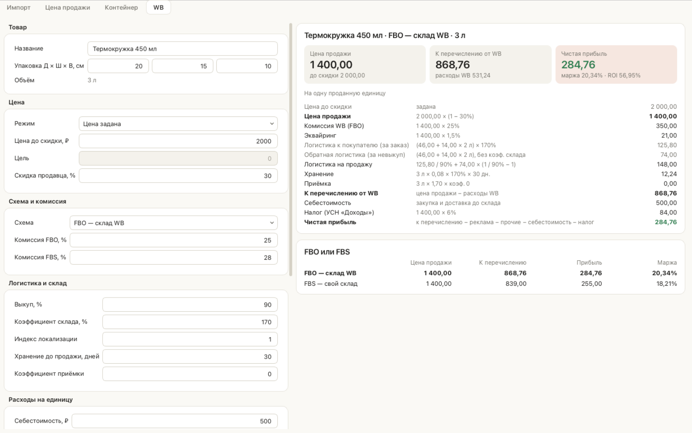
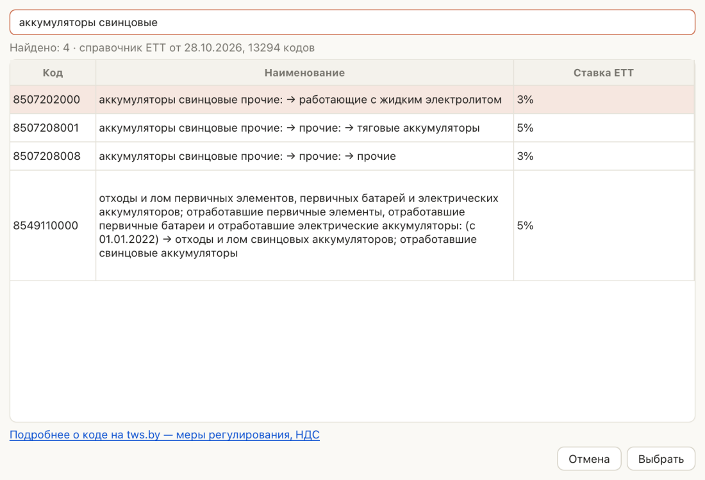

# Калькулятор ВЭД

Десктоп-приложение для macOS. Оно считает **полную себестоимость импорта** партии товара в РФ:
товар, логистику, таможенный сбор, пошлину и НДС при ввозе. По себестоимости оно считает
**цену продажи B2B-клиенту**: с заданной наценкой, маржой или чистой прибылью, с учётом
стоимости денег. Есть и обратный расчёт: по известной цене программа показывает прибыль и
рентабельность.

Окно разделено на вкладки:
- **«Импорт»** — себестоимость партии и единицы товара, подсказка о загрузке контейнера.
- **«Цена продажи»** — цена и прибыль. Себестоимость берётся из вкладки «Импорт» или
  вводится вручную.
- **«Контейнер»** — отдельный модуль: укладка до 20 видов грузовых мест в морской
  контейнер, схема раскладки и выбор подходящего типа контейнера.
- **«WB»** — отдельный модуль: юнит-экономика Wildberries для ИП на УСН — прибыль с одной
  продажи по FBO и FBS, подбор цены под маржу или прибыль.

Это первый модуль будущей платформы инструментов ВЭД. Ядро расчётов не зависит от
интерфейса, поэтому поверх него можно сделать CLI, веб-версию или API.








> Программа даёт оценку для управленческого решения. Она **не заменяет консультацию
> таможенного брокера и бухгалтера**.

## Возможности

- Несколько позиций в одной партии. У каждой позиции своя валюта, ставка пошлины и ставка
  НДС (22%, 10% или 0%), единицы — шт, кг или т.
- Расходы партии с признаками «включается в таможенную стоимость» и «сумма с НДС»,
  входящий НДС по российским услугам принимается к вычету.
- Курсы ЦБ РФ на дату расчёта загружаются в фоне, учитывают номинал и кэшируются.
  Без интернета берётся последний сохранённый курс с предупреждением. Курс можно задать
  вручную для сценария «что если».
- Таможенный сбор считается по шкале 2026 года от общей таможенной стоимости партии.
- **Ставки по коду ТН ВЭД**: при вводе 10-значного кода пошлина подставляется из
  встроенного справочника ЕТТ (13 тыс. кодов) — адвалорная, специфическая и комбинированная;
  подбор кода по словам наименования без интернета.
- Налоговые режимы импортёра: ОСН (НДС к вычету) и УСН «доходы минус расходы» без НДС.
- Цена продажи — с наценкой, с маржинальностью, с целевой чистой прибылью, по цене за
  единицу или обратный расчёт по цене партии. Учитываются расходы, зависящие от выручки:
  комиссия, эквайринг, бонус клиенту.
- **Стоимость денег**: проценты за деньги, вложенные в партию, упрощённо или по графику
  платежей поставщику и от покупателя. Учитывается в цене и прибыли.
- **Подсказка о загрузке контейнера**: какая доля контейнера занята по объёму и по весу,
  предупреждение, если груз не помещается в один контейнер.
- **Упор на единицу товара**: себестоимость, цена и прибыль за 1 шт, 1 кг или 1 т
  (как задана позиция), с разбивкой по статьям. Итоги партии — ниже.
- Пересчёт на лету и пошаговая детализация всех формул с подставленными числами.
- Оформление в духе приложения Claude для macOS: тёплая светлая палитра, карточки, формулы
  моноширинным шрифтом.
- Один файл проекта (JSON) на все вкладки, включая «Контейнер» и «WB»; список последних
  файлов, автосохранение и восстановление после сбоя. Расчёт можно дублировать, результат
  экспортируется в PDF и XLSX.
- **Коммерческое предложение** для клиента в PDF и DOCX: цены, НДС, условия оплаты и
  поставки, реквизиты, логотип, подпись и печать — без себестоимости и наценки.

## Установка

### Готовая сборка (.dmg)

1. Скачайте `.dmg` со страницы **Releases** этого репозитория.
   Сборка выпускается только для Mac на Apple Silicon (M1 и новее), файл `*-macos-arm64.dmg`.
   Для Mac на Intel готовой сборки нет — только запуск из исходников.
2. Откройте `.dmg` и перетащите «Калькулятор ВЭД» в «Программы».
3. При первом запуске macOS предупредит, что приложение от неустановленного разработчика:
   сборка пока не подписана сертификатом Apple Developer. Откройте приложение через
   **правый клик → «Открыть» → «Открыть»**. Если кнопки «Открыть» нет, разрешите запуск в
   «Системные настройки → Конфиденциальность и безопасность → Всё равно открыть».

### Обновление

Начиная с версии 0.2.0 программа обновляется сама. Раз в сутки при запуске (и по команде
**Справка → Проверить обновления…**) она смотрит последний релиз на GitHub. Если вышла новая
версия, программа показывает список изменений. Дальше можно выбрать:

- **Установить и перезапустить.** Программа скачает `.dmg` для вашего Mac и сверит его
  контрольную сумму SHA-256. После выхода она заменит себя новой версией и запустится снова.
  Перед выходом она спросит, сохранить ли открытый расчёт.
- **Скачать вручную.** Откроется ссылка на `.dmg`.
- **Пропустить эту версию** или **Позже**.

Ограничения:
- Обновиться с 0.1.0 на 0.2.0 нужно вручную, потому что в 0.1.0 этой функции ещё нет.
  Перетащите новое приложение в «Программы» и выберите «Заменить».
- Если у программы нет прав на запись в папку, где она установлена, доступно только
  скачивание вручную.

Если API GitHub временно недоступен (например, исчерпан лимит запросов), программа
берёт версию и контрольные суммы напрямую со страницы релизов.

Файлы расчётов и кэш курсов при обновлении сохраняются.

### Из исходников

Нужен Python 3.12 или новее.

```bash
git clone <адрес репозитория> vedcalc
cd vedcalc
python3 -m venv .venv
.venv/bin/pip install -e ".[gui,dev]"
.venv/bin/python -m vedcalc        # запуск приложения
.venv/bin/pytest                   # тесты
.venv/bin/ruff check .             # линтер
```

Собрать `.app` и `.dmg` локально:

```bash
scripts/build_macos.sh             # результат — в dist/
```

## Быстрый старт: контрольный пример

**Файл → Открыть контрольный пример**. Условия примера:

| Параметр | Значение |
|---|---|
| Товар | 100 000 ₽, 1 позиция, пошлина 5%, НДС 22% |
| Доставка до границы | 30 000 ₽ (входит в таможенную стоимость, НДС 0%) |
| Доставка по РФ | 10 000 ₽ (часть международной перевозки, НДС 0%) |
| Режим | ОСН, налог на прибыль 25% |

Ожидаемый результат (совпадает до копейки, проверяется тестом `tests/test_control_example.py`):

| Показатель | Значение |
|---|---|
| Таможенная стоимость | 130 000,00 |
| Таможенный сбор (ТС ≤ 200 000) | 1 231,00 |
| Пошлина | 6 500,00 |
| НДС при ввозе = НДС к вычету | 30 030,00 |
| **Себестоимость без НДС (C)** | **147 731,00** |
| Продажа за 200 000 без НДС: чистая прибыль (вкладка «Цена продажи») | 39 201,75 |
| Наценка / маржинальность | 35,38% / 26,13% |

## Методика расчёта

Все суммы переводятся в рубли по курсу ЦБ РФ на дату расчёта (или по ручному курсу).

### Себестоимость

1. **Распределение расходов партии** по позициям: пропорционально стоимости товара (по
   умолчанию) или весу брутто. Доли округляются до копеек, остаток от округления относится
   на последнюю позицию.
2. **Таможенная стоимость (ТС)** позиции = стоимость товара + доля расходов
   с признаком «включается в ТС», без НДС.
3. **Таможенный сбор** = по шкале от **общей ТС** партии (одна ДТ). По позициям сбор
   распределяется пропорционально ТС. Сбор **не входит** в базу пошлины и НДС.
4. **Пошлина** = ТС × ставка (адвалорная).
5. **НДС при ввозе** = (ТС + пошлина + акциз) × ставка НДС.
6. **Себестоимость без НДС (C)** = товар + все расходы без НДС + сбор + пошлина + акциз.
   - ОСН: НДС при ввозе и входящий НДС по услугам в себестоимость не входят. Это
     **НДС к вычету I**, он показывается отдельно.
   - УСН без НДС: весь НДС включается в себестоимость.
7. **Себестоимость единицы** = себестоимость позиции / количество.

Пошлина и НДС при ввозе округляются до копеек по каждой позиции, остальное — только при
выводе. Деньги считаются в `Decimal`, без `float`.

### Цена продажи

Обозначения:
- C — себестоимость без НДС;
- P — выручка без НДС;
- v — НДС при продаже (22%);
- t — налог на прибыль (25%; при УСН — ставка УСН, 15%);
- r — доля расходов, зависящих от цены (без НДС);
- F — стоимость денег (см. ниже).

| Показатель | Формула |
|---|---|
| Валовая прибыль G | P − C − r·P − F |
| Налог на прибыль | max(0, G) × t |
| Чистая прибыль | G − налог |
| Наценка | G / (C + F) |
| Маржинальность | G / P |
| НДС к уплате (справочно) | D = P·v − I |

| Режим | Цена без НДС |
|---|---|
| Наценка k | P = (C + F) · (1 + k) / (1 − r) |
| Маржинальность m | P = (C + F) / (1 − m − r) |
| Целевая чистая прибыль N | P = (C + F + N / (1 − t)) / (1 − r) |
| Цена за единицу (одна позиция) | P = цена за 1 ед. × количество |
| Обратный расчёт | P задана, считаются все показатели |

При r = 0 и F = 0 формулы совпадают с классическими: P = C·(1+k), P = C/(1−m), P = C + N/(1−t).

**НДС к уплате** — не расход: он платится из НДС, полученного от покупателя, и в прибыль не
входит.

### Что если

На вкладке «Цена продажи», когда себестоимость взята из импорта, блок «Что если» показывает,
как меняются себестоимость, чистая прибыль и маржинальность. Цена продажи при этом не
меняется — она уже согласована с клиентом.

- **Курс**: −15…+15 % с шагом 5 %, все валюты партии на один процент; график прибыли.
- **Фрахт**: ±10 и ±20 % к расходам «Доставка до границы» и «Доставка по РФ».
- **Пошлина**: ±5 п. п. к процентной части ставки каждой позиции (не ниже 0 %),
  специфическая часть не меняется; плюс своя адвалорная ставка для всех позиций.

Каждый сценарий — полный пересчёт импорта: таможенная стоимость, пошлина, НДС, сбор.
Таблицы попадают в PDF и на лист «Что если» в XLSX.

### Стоимость денег

Проценты за деньги, вложенные в партию до оплаты покупателем. Ставка — % годовых; доля
заёмных средств (по умолчанию 100%) позволяет учесть, что часть денег — собственные.

- **Упрощённо:** F = сумма × ставка × дни / 365 × доля заёмных. Сумма по умолчанию —
  себестоимость партии с НДС.
- **По графику платежей** (дни от предоплаты поставщику):

  | День | Событие |
  |---|---|
  | 0 | предоплата поставщику, % стоимости товара |
  | N₁ | остаток поставщику |
  | N₁ + перевозка | прибытие: оплата логистики и прочих расходов |
  | + растаможка | выпуск: пошлина, НДС при ввозе, сбор |
  | + доставка | поставка покупателю |
  | задаётся | предоплата покупателя, % цены с НДС |
  | поставка + отсрочка | оплата остатка покупателем |

  F = Σ max(0, вложено) × дни × ставка / 365 × доля заёмных. Суммы — с НДС.

F зависит от цены (предоплата покупателя сокращает вложения), поэтому цена для режимов
«наценка», «маржа» и «прибыль» уточняется итерациями, пока F не перестанет меняться.

### Загрузка контейнера

Если способ доставки — контейнер (20' DC/HC, 40' DC/HC, 45' PW/HC PW) и у позиций указаны
вес брутто и объём (на всю позицию), вкладка «Импорт» показывает, какая доля контейнера
занята по объёму и по весу. Если груз не помещается, появляется предупреждение и число
нужных контейнеров. Внутренние размеры — в `vedcalc/data/containers.json`; предельный вес
груза: 20' — 27 т, 40' и 45' — 26 т.

- **Без упаковки** — прикидка по сумме объёмов и весов позиций, без учёта укладки.
- **С упаковкой** (кнопка «Упаковка…» в строке позиции: размеры и вес брутто места, сколько
  товара в месте, кантование, ярусы) — места всех позиций укладываются тем же алгоритмом,
  что во вкладке «Контейнер». Число мест = количество / в месте, с округлением вверх.
  «Показать укладку» открывает места партии во вкладке «Контейнер».
- **Фрахт за контейнер** — поле под способом доставки. В расходы автоматически
  добавляется «Фрахт за контейнер: N × ставка» (доставка до границы, в таможенной
  стоимости, НДС 0%). N — по укладке, иначе по объёму и весу, или вручную.

### На единицу товара

Для каждой позиции программа показывает расчёт за 1 шт, 1 кг или 1 т — в той единице,
в которой задано количество:

- Статьи себестоимости делятся на количество: товар, доставка до границы, пошлина, сбор,
  прочие расходы.
- Каждая статья округляется до копеек. Себестоимость единицы — сумма округлённых статей.
- Цена и прибыль на единицу считаются от себестоимости единицы по тем же формулам. Например,
  для наценки: цена = (себестоимость единицы + стоимость денег на единицу) × (1 + k).

Так каждая формула на экране сходится до копейки. Итоги по партии считаются отдельно, поэтому
«цена единицы × количество» может отличаться от цены партии на несколько копеек.


### Файл проекта и автосохранение

Файл → «Сохранить» (⌘S) записывает все вкладки в один файл `*.vedcalc.json`: импорт, цену
продажи, «Контейнер» и «WB». Ввод модулей сохраняется как набран, даже с ошибками. Последние
10 файлов — в Файл → «Открыть последние».

Раз в минуту несохранённые изменения копируются в `~/Library/Application Support/vedcalc/recovery`
(ваш файл при этом не меняется). Если программа закрылась аварийно, при следующем запуске
она предложит восстановить расчёт. После сохранения или осознанного закрытия копия удаляется.

### Коммерческое предложение

На вкладке «Цена продажи» кнопка «Коммерческое предложение…» (или Файл → Ctrl+K) открывает
окно КП с предпросмотром. В КП попадают только цены и условия: себестоимость, наценка,
прибыль и стоимость денег остаются внутри программы.

- Цена за единицу — с НДС (при УСН — без НДС, с пометкой «НДС не облагается»). Сумма
  позиции = округлённая цена × количество, поэтому клиент может пересчитать её сам.
  НДС выделяется из суммы: НДС = сумма × ставка / (100 + ставка).
- Условия оплаты и срок поставки подставляются из графика «Стоимость денег», их можно
  поправить. Срок действия КП — в днях от даты КП.
- Стили: «В стиле программы», «Нейтральный деловой», «Строгий монохром». Логотип, подпись,
  печать и колонка «Код ТН ВЭД» включаются галочками; выбор запоминается.
- Реквизиты продавца — Файл → «Мои реквизиты…». Они и картинки хранятся на этом Mac
  (`~/Library/Application Support/vedcalc`), а не в файле расчёта.

### Модуль «Контейнер»

Отдельная вкладка, с расчётом импорта не связана. Для каждого вида грузовых мест (до 20)
задаются размеры и вес одного места в сантиметрах и килограммах, количество, можно ли
кантовать (класть на бок), штабелировать и сколько ярусов допустимо.

Метод — «стенками» вдоль контейнера:
1. Для очередной поперечной стенки перебираются варианты её глубины (размер места,
   2–3 места, общие кратные — например 2 400 мм = 3 × 800 = 2 × 1 200).
2. Стенка заполняется как раскладка «ширина × высота»: крупные места, затем остатки сверху
   и сбоку — другими видами. Выбор варианта — с заглядыванием на шаг вперёд.
3. На места без штабелирования и с пределом ярусов ничего не ставится.
4. Общий вес груза ограничен: 20' — 27 т, 40' и 45' — 26 т.
5. Перебираются четыре стратегии порядка мест, берётся лучший результат.

Проверка на эталонах: европаллеты 1 200 × 800 в один ярус — 11 в 20', 25 в 40', 33 в 45' PW
(совпадает с отраслевыми нормами). Для смешанного груза раскладка приближённая: все
варианты не перебираются, полной гарантии оптимума нет.

Результат: число контейнеров, загрузка каждого по объёму и весу, схема сверху и сбоку,
сравнение всех типов с отметкой лучшего (меньше контейнеров, затем меньше общий объём).

### Модуль «WB» (юнит-экономика Wildberries)

Отдельная вкладка, с импортом не связана. Всё — на одну **проданную** единицу; при выкупе b
на продажу приходится 1/b заказов.

| Статья | Формула |
|---|---|
| Цена продажи P | цена до скидки × (1 − скидка продавца) — база комиссии, эквайринга, рекламы, налога |
| Комиссия | P × % комиссии категории (отдельно для FBO и FBS, из кабинета) |
| Эквайринг | P × % (по умолчанию 1,5%) |
| Логистика за заказ | тариф(литры) × коэф. склада (170%) × ИЛ; до 1 л — 23/26/29/30/32 ₽ по диапазонам, свыше — 46 ₽ + 14 ₽ за каждый следующий литр (дробно) |
| Обратная логистика | тариф(литры) без коэффициента склада — за каждый невыкуп |
| Логистика на продажу | прямая / b + обратная × (1/b − 1) |
| Хранение (FBO) | литры × 0,08 ₽ × коэф. склада × дни хранения |
| Приёмка (FBO) | литры × 1,7 ₽ × коэф. приёмки (0 — бесплатно) |
| К перечислению | P − комиссия − эквайринг − логистика − хранение − приёмка |
| Налог УСН «Доходы» | P × ставка (1–8%) |
| Налог УСН «Доходы − расходы» | max((P − все расходы) × ставка; 1% от P) |
| Прибыль | к перечислению − реклама − прочие − себестоимость − налог |

Маржа = прибыль / P, ROI = прибыль / себестоимость. Режимы «подобрать цену под маржу» и
«под прибыль» находят цену до скидки делением отрезка пополам с точностью до копейки.

**Тарифы WB** — в `vedcalc/data/wb_tariffs.json` (короба, малогабарит; действуют
с 15.08.2026, сверены 28.10.2026). Базовые тарифы можно поправить прямо во вкладке.
Тарифы меняются часто — сверяйте с разделом «Тарифы» в кабинете продавца.

**Тарифы WB по API.** В кабинете продавца создайте токен: Настройки → Доступ к API,
категория «Тарифы», «Только чтение». Во вкладке «WB» нажмите «Токен…» и вставьте его:
токен хранится в Связке ключей macOS и отправляется только на `common-api.wildberries.ru`.
После «Обновить» программа загрузит комиссии по предметам и тарифы коробов по складам.

- **Предмет** — подставляет комиссию FBO («Склад WB») и FBS («Маркетплейс»).
- **Склад** — подставляет логистику первого и дополнительного литра и коэффициент склада,
  для FBO ещё хранение и коэффициент хранения. WB отдаёт суммы уже с коэффициентом;
  программа делит их на коэффициент, чтобы обратная логистика считалась без него.
  Для FBS берутся тарифы FBS склада.
- Данные кэшируются и обновляются при открытии вкладки, если старше суток.
  Лимит WB на комиссии — 1 запрос в минуту. Без токена всё вводится вручную, как раньше.

**Список товаров.** Переключатель «Один товар / Список товаров» над вкладкой «WB».
В режиме списка загрузите XLSX или CSV (CSV — с разделителем «;» или «,», UTF-8 или
Windows-1251); «Скачать шаблон» даёт файл с подписанными колонками и примерами.

- Обязательные колонки: «Название», «Длина, см», «Ширина, см», «Высота, см»,
  «Себестоимость, ₽». Необязательные: «Цена до скидки, ₽», «Скидка, %», «Предмет WB»,
  «Комиссия FBO, %», «Комиссия FBS, %», «Выкуп, %», «Реклама, %», «Прочие, ₽».
  Порядок колонок не важен, подойдут и варианты вроде «Длина» или «length».
- Пустая ячейка — значение из формы слева; оттуда же схема, налог, тарифы и склад.
  Комиссия по «Предмету WB» берётся из тарифов WB по API. Без цены цена подбирается
  под цель формы (маржа или прибыль).
- В таблице: цена, к перечислению, прибыль, маржа, ROI и прибыль по другой схеме при
  той же цене. Убыточные — красным, маржа ниже порога (по умолчанию 10 %) — жёлтым.
  Строки с ошибками показаны с причиной и не мешают остальным.
- «Выгрузить в Excel» сохраняет таблицу с подсветкой и итогами; список хранится в файле
  проекта.

## Источники данных и как их обновить

### Курсы валют

- Источник: ЦБ РФ, `https://www.cbr.ru/scripts/XML_daily.asp?date_req=ДД/ММ/ГГГГ`.
- **Все курсы берутся на дату расчёта**: к товару, логистике и базе таможенных платежей.
  Курсы на дату оплаты и на дату регистрации ДТ заранее неизвестны.
- Кэш хранится в `~/Library/Application Support/vedcalc/fx_cache.json`. Если удалить
  файл, курсы загрузятся заново.

### Справочник ТН ВЭД и ставок ЕТТ

- Файл `vedcalc/data/tnved_tws.json` — коды ТН ВЭД ЕАЭС, наименования и ставки ввозной
  пошлины из бесплатной ежедневной выгрузки [tws.by](https://www.tws.by/tws/tnved)
  («как есть, без гарантий»). НДС, акцизов и мер нетарифного регулирования в выгрузке нет —
  их видно по ссылке «Подробнее» в подборе кода; в расчёте они задаются вручную.
- Справочник вшит в программу и обновляется вместе с ней. Раз в месяц GitHub Actions
  (`tnved-update.yml`) скачивает свежую выгрузку и, если ставки изменились, открывает PR
  с новой версией программы. Если справочнику больше 35 дней, программа напоминает
  обновиться.
- Обновить вручную: `python scripts/update_tnved.py` (печатает изменения ставок).


- Специфическая часть ставки считается по курсу ЦБ на дату расчёта от количества:
  за кг / т — вес нетто; за шт — количество; за л, пары, м², см³ — поле
  «Кол-во в ед. ставки». «Не менее» — большая из двух частей, «плюс» — сумма.

### Шкала таможенных сборов

- Файл `vedcalc/data/customs_fees_2026.json`.
- Основание: **ПП РФ от 28.11.2024 № 1637 в ред. ПП РФ от 23.10.2025 № 1638**,
  действует с **01.01.2026**.
- Пороги сверены 26.10.2026 с текстом постановления и таблицей ФТС
  ([customs.gov.ru](https://customs.gov.ru/fiz/uplata-tamozhennyx-platezhej/stavki-tamozhennyx-sborov-za-sovershenie-tamozhennyx-operaczij,-svyazannyx-s-vypuskom-tovarov-dlya-lichnogo-pol-zovaniya)).

| Общая таможенная стоимость, руб. | Сбор, руб. |
|---|---|
| до 200 000 включительно | 1 231 |
| 200 000,01 – 450 000 | 2 462 |
| 450 000,01 – 1 200 000 | 4 924 |
| 1 200 000,01 – 2 700 000 | 13 541 |
| 2 700 000,01 – 4 200 000 | 18 465 |
| 4 200 000,01 – 5 500 000 | 21 344 |
| 5 500 000,01 – 10 000 000 | 49 240 |
| свыше 10 000 000 | 73 860 |

Когда выйдет новая шкала:
1. Создайте файл `customs_fees_<год>.json` в том же формате: `valid_from`, `legal_basis`,
   `source_url`, `brackets`. Последний порог — `"up_to": null`.
2. Поменяйте `DEFAULT_SCALE` в `vedcalc/core/fees.py`.
3. Обновите тест границ `tests/test_fees.py`.

Если дата расчёта выходит за период действия шкалы, программа показывает предупреждение.

### Ставки по умолчанию

`vedcalc/data/settings.json`: НДС, налог на прибыль, ставка УСН, список валют.

## Допущения и ограничения

Полный список — в [docs/ASSUMPTIONS.md](docs/ASSUMPTIONS.md). Главное:

- один курс ЦБ на дату расчёта для всех операций;
- одна декларация на партию;
- пошлина только адвалорная: специфическая и комбинированная ставки есть в модели,
  но пока не считаются;
- акциз вводится вручную;
- не учитываются особые ставки сбора (радиоэлектроника), преференции по стране
  происхождения и антидемпинговые пошлины;
- УСН «доходы» и УСН с НДС 5% или 7% не поддерживаются;
- налог на прибыль считается по одной сделке, без учёта прочих доходов и убытков компании.

## Дорожная карта

Список улучшений с отметками о выполнении — в [docs/ROADMAP.md](docs/ROADMAP.md).

## Структура проекта

```
vedcalc/
  core/        ядро без GUI: models, money, units, fx, fees, customs, costing,
               pricing, validation, report, io, settings
  providers/   интерфейсы внешних источников (tnved.py — заглушка)
  modules/     будущие модули и реестр вкладок (registry.py)
  reports/     HTML- и XLSX-отчёты, коммерческое предложение (HTML, DOCX)
  gui/         PySide6: главное окно, форма, результаты, экспорт PDF
  data/        шкала сборов, настройки, контрольный пример
tests/         pytest; GUI-тесты — pytest-qt (без экрана)
docs/          ASSUMPTIONS.md, скриншоты
scripts/       сборка .app и .dmg
```

Новые модули подключаются как вкладки главного окна через
`vedcalc.modules.registry.register(...)`, без правки ядра.

## Как внести вклад

1. Ветка `main` защищена, изменения вносятся только через pull request.
2. Создайте ветку от `main`: `feature/<кратко>` или `fix/<кратко>`.
3. Перед PR выполните `ruff check .`, `ruff format --check .` и `pytest`. CI проверит то же
   самое.
4. Любое изменение методики сопровождается тестом с ручным расчётом и записью в
   `docs/ASSUMPTIONS.md`.
5. Запишите изменения в `CHANGELOG.md` в раздел «Не выпущено».

Релиз: обновить версию в `pyproject.toml` и `vedcalc/__init__.py`, перенести записи
в `CHANGELOG.md` и поставить тег `vX.Y.Z`. GitHub Actions соберёт `.dmg` и опубликует
GitHub Release.

## История версий

См. [CHANGELOG.md](CHANGELOG.md).

## Лицензия

Проприетарная, все права защищены. См. [LICENSE](LICENSE).
